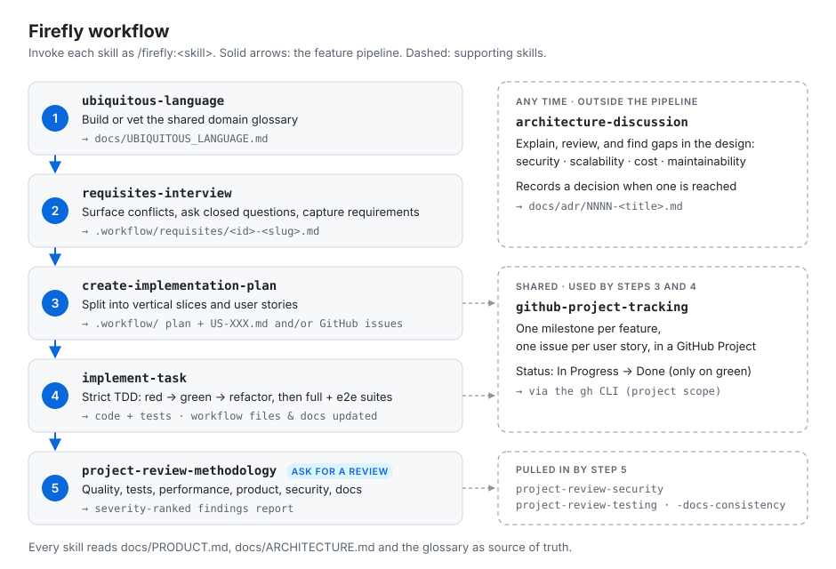

# Firefly Harness

A [Claude Code](https://claude.com/claude-code) plugin that bundles a set of **skills** for a disciplined, spec-driven development workflow: capture requirements, build a shared domain language, turn requirements into a vertical-slice plan, implement each task with strict TDD, and review the result against the project's product, architecture, security, test, and documentation standards.

The skills are deliberately stack-agnostic — they encode a *methodology* (DDD glossary → requisites → plan → TDD implementation → review), not a specific language or framework.

## The workflow

<p align="center">
  
</p>

## What's inside

### Workflow skills (you invoke these explicitly)

| Skill | What it does |
| --- | --- |
| `ubiquitous-language` | Extracts a DDD-style glossary of domain terms, flags ambiguities, proposes canonical names, and vets new terms against the existing glossary. Saves to `docs/UBIQUITOUS_LANGUAGE.md`. |
| `requisites-interview` | Captures requirements for a new feature: reads the product/architecture/glossary docs, surfaces conflicts, asks closed clarifying questions, and writes `.workflow/requisites/<id>-<slug>.md`. |
| `create-implementation-plan` | Turns a requisites file into a vertical-slice implementation plan plus one user story per slice. Asks whether to write them as local markdown under `.workflow/implementation-plans/` and `.workflow/tasks/`, publish them to GitHub (one milestone per feature, one issue per user story, added to a GitHub Project), or both. |
| `implement-task` | Implements a single task end-to-end with strict TDD (red → green → refactor), runs the full test + e2e suites, and updates the workflow files and docs. If the task is an issue in a GitHub Project, moves it to In Progress at the start and to Done when finished. |
| `architecture-discussion` | Discusses how to evolve the architecture, explains implementation/technology aspects, reviews a solution and proposes improvements, and detects gaps across security, scalability, cost-effectiveness, and maintainability. Records an ADR under `docs/adr/` when a decision is reached or when you ask for one. |


### Review skills (invoked automatically by Claude during a review)

| Skill | What it does |
| --- | --- |
| `project-review-methodology` | Orchestrates a structured review across code quality, tests, performance, product alignment, security, and docs, then returns prioritized findings. |
| `project-review-security` | Reviews input validation, multi-user data isolation, injection/XSS risks, and sensitive-data exposure. |
| `project-review-testing` | Reviews test coverage and quality: edge cases, error paths, integration scenarios, vertical-slice completeness. |
| `project-review-docs-consistency` | Checks that `docs/PRODUCT.md`, `docs/ARCHITECTURE.md`, READMEs, and comments still match the implementation. |

These skills set `user-invocable: false` — you don't call them directly; the review methodology (or Claude) pulls them in when relevant.

### Shared skills (invoked by other skills)

| Skill | What it does |
| --- | --- |
| `github-project-tracking` | Single source of truth for GitHub Projects: issue naming conventions, `gh` preflight, project selection, publishing a plan as a milestone with one issue per user story, locating a task's issue, and moving its Status. Used by `create-implementation-plan` and `implement-task`. Requires the [GitHub CLI](https://cli.github.com/) with the `project` scope (`gh auth refresh -s project`). |

Also `user-invocable: false`.


## Expected project layout

The skills read from and write to a conventional structure. They degrade gracefully when files are missing, but you get the most out of the plugin when the target project has:

```
your-project/
├── CLAUDE.md                      # conventions, layering, prohibited patterns
├── docs/
│   ├── PRODUCT.md                 # scope, features, product decisions
│   ├── ARCHITECTURE.md            # folder structure, slice boundaries, conventions
│   ├── UBIQUITOUS_LANGUAGE.md     # canonical domain glossary
│   ├── DESIGN.md                  # design system / tokens (for UI work)
│   └── adr/                       # architecture decision records (NNNN-title.md)
└── .workflow/
    ├── requisites/                # requisites-interview output
    ├── implementation-plans/      # create-implementation-plan output
    └── tasks/<id>-<slug>/US-XXX.md
```

## Project structure

```
firefly-harness-plugin/
├── .claude-plugin/
│   ├── plugin.json                # Plugin manifest (name, version, metadata)
│   └── marketplace.json           # Marketplace manifest (lets the repo be installed directly)
├── assets/
│   └── workflow.svg               # Workflow diagram used in this README
├── skills/                        # One folder with a SKILL.md per skill
│   ├── ubiquitous-language/
│   ├── requisites-interview/
│   ├── create-implementation-plan/
│   ├── implement-task/
│   ├── github-project-tracking/
│   ├── architecture-discussion/
│   ├── project-review-methodology/
│   ├── project-review-security/
│   ├── project-review-testing/
│   └── project-review-docs-consistency/
└── README.md
```

## Installation

A plugin is always installed **through a marketplace**. This repo doubles as its own
marketplace: `.claude-plugin/marketplace.json` declares the `firefly-harness` marketplace
and points it at the `firefly` plugin (`"source": "."`). So adding the repo as a
marketplace is all you need.

The plugin is published at
[`asiermarques/firefly-harness-plugin`](https://github.com/asiermarques/firefly-harness-plugin).
Inside Claude Code, on any machine:

```
/plugin marketplace add asiermarques/firefly-harness-plugin
/plugin install firefly@firefly-harness
```

(`firefly` is the plugin name, `firefly-harness` is the marketplace name.)

After installing, restart Claude Code (or run `/reload-plugins`) so the new skills are picked up.

### Updating

Auto-update is off by default, so pull new versions yourself. Inside Claude Code:

1. Open `/plugin` → **Marketplaces** tab → select `firefly-harness` → **Update marketplace**.
   This refreshes the listing and updates the plugins installed from it.
   (Alternatively: **Installed** tab → `firefly` → **Update now**.)
2. Run `/reload-plugins` (or start a new session) to load the new version.

Or from your shell:

```bash
claude plugin marketplace update firefly-harness   # refresh the marketplace listing
claude plugin update firefly@firefly-harness       # install the newer plugin version
```

`claude plugin marketplace update` alone only refreshes the listing — it doesn't touch
installed plugins, so run both. If nothing newer is published you'll see
`firefly is already at the latest version (…)`.

An update is only detected when the `version` in `.claude-plugin/plugin.json` changes on
GitHub — see [Publishing changes](#publishing-changes).

### Trying local changes before publishing

The installed plugin comes from GitHub, not from your working copy. To test unpublished
edits, swap the GitHub marketplace for your local clone (both declare the same
`firefly-harness` name, so remove the GitHub one first):

```
/plugin marketplace remove firefly-harness
/plugin marketplace add ./path/to/firefly-harness-plugin
/plugin install firefly@firefly-harness
```

## Usage

Plugin skills are namespaced with the plugin name, so you invoke them as `/firefly:<skill>` — e.g. `/firefly:requisites-interview add tags for users`.

Run the workflow skills in order for a new feature:

1. **Harden terminology** — invoke `ubiquitous-language` to capture or vet the domain terms for the feature.
2. **Capture requirements** — invoke `requisites-interview` with the feature request. It interviews you and writes a requisites file.
3. **Plan** — invoke `create-implementation-plan` with the requisites file. It produces a vertical-slice plan and per-user-story task files.
4. **Implement** — invoke `implement-task` with a task description (or user story). It drives the TDD loop, runs the suites, and updates the docs/workflow files.
5. **Review** — ask Claude to review the changes; it pulls in `project-review-methodology` and the specialized `project-review-*` skills automatically and returns prioritized findings.

Outside this linear flow, invoke `architecture-discussion` whenever you want to think through a design, evaluate a technology choice, weigh trade-offs, or capture an architecture decision as an ADR — before, during, or after the pipeline.

You can confirm what loaded with `/plugin` (lists installed plugins).

## Customizing

- **Add a skill** — create `skills/<your-skill>/SKILL.md` with `name` and `description` frontmatter. The `description` is what Claude uses to decide when a model-invoked skill applies. Set `disable-model-invocation: true` for skills only you should trigger, or `user-invocable: false` for skills only Claude should pull in.
- **Add a command** — create `commands/<name>.md`; the file body is the prompt, and `$ARGUMENTS` is substituted with whatever the user types after the command.
- **Adapt to your stack** — the skills reference a `docs/` + `.workflow/` layout and a layered backend / vertical-slice convention. Adjust the SKILL.md bodies to match your project's actual conventions.

### Publishing changes

1. Bump the `version` in `.claude-plugin/plugin.json` (semver: patch for fixes, minor for new skills or behavior changes). Without a version bump, installed copies won't see the update.
2. Commit and push to `main`.
3. Update the installed plugin as described in [Updating](#updating).

## License

MIT
